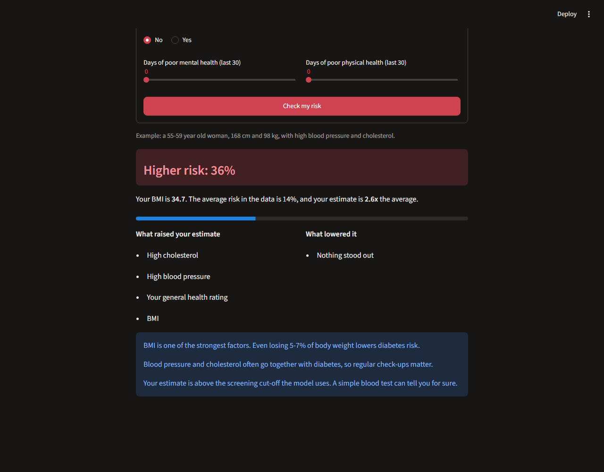
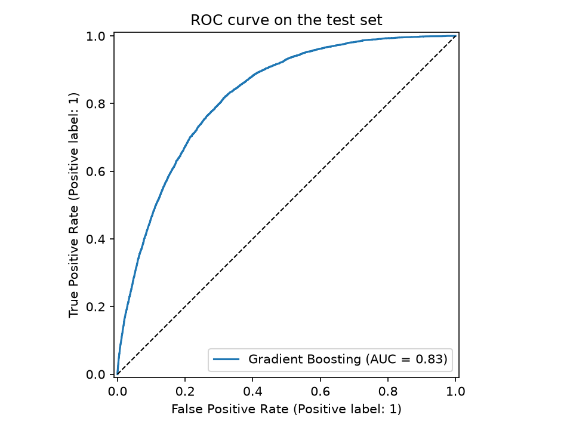
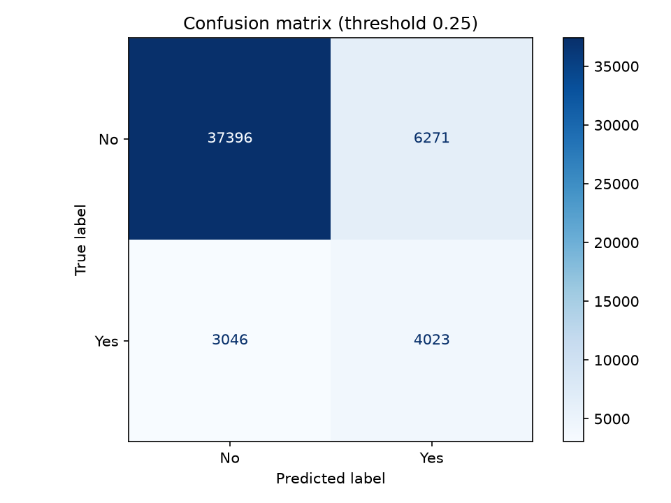
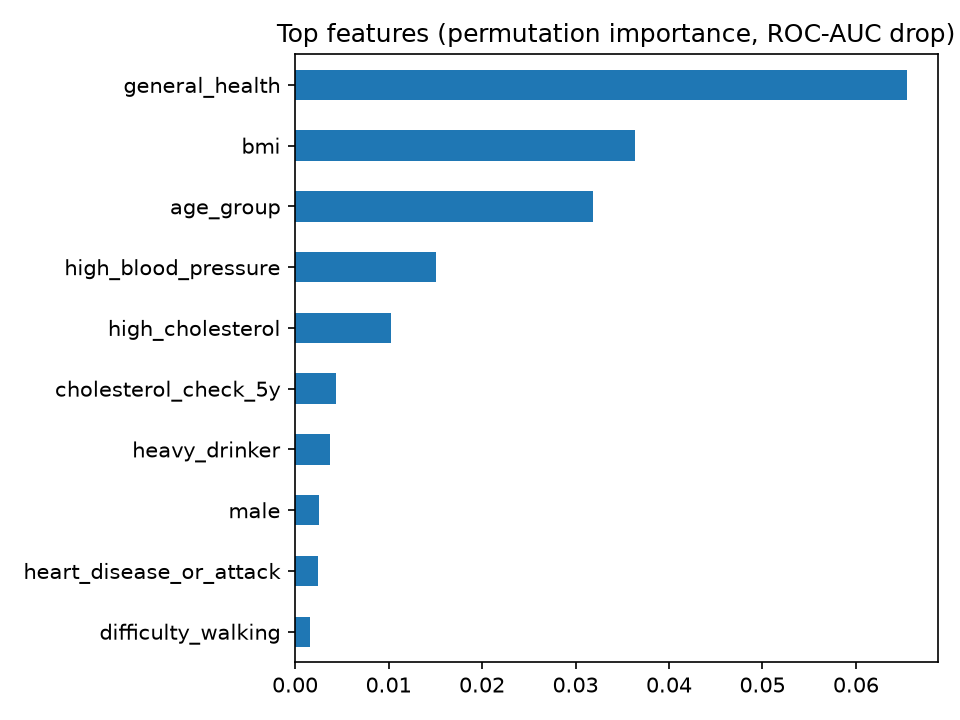

# Diabetes Risk Checker

Live app: https://pamithu-diabetes-risk.streamlit.app

A machine learning app that estimates the risk of prediabetes or diabetes from simple health and lifestyle questions like BMI, blood pressure, cholesterol, age and exercise.



## Why I made this

Diabetes affects more than 500 million adults worldwide, and a lot of people with prediabetes don't know they have it. Most of the warning signs are things people can answer themselves, so I wanted to see how well a model could flag higher-risk people from a short questionnaire.

This is a learning project, not a medical test. Only a blood test (HbA1c or fasting glucose) can diagnose diabetes.

## Dataset

I used the [CDC Diabetes Health Indicators](https://archive.ics.uci.edu/dataset/891/cdc+diabetes+health+indicators) dataset from the UCI Machine Learning Repository. It comes from the CDC's BRFSS phone survey of US adults.

- 253,680 survey answers, no missing values
- Target: told by a doctor they have prediabetes or diabetes (13.9% of people)
- Very imbalanced, which turned out to be the main challenge

## What I did

I used 17 questions a person can answer about their own health: BMI, high blood pressure, high cholesterol, cholesterol check, smoking, stroke, heart disease, exercise, fruit, vegetables, heavy drinking, general health, bad mental and physical health days, difficulty walking, sex and age group.

I left out income, education and health insurance. I tested adding them back and the cross-validated ROC-AUC only went from 0.829 to 0.830, so they weren't worth asking people about.

I compared three models with 5-fold cross-validation on 80% of the data (202,944 people):

| Model | CV ROC-AUC |
|---|---|
| Gradient Boosting | 0.829 |
| Random Forest | 0.826 |
| Logistic Regression | 0.822 |

Then I tested Gradient Boosting on the other 20% (50,736 people).

## Results

| Metric | Test score |
|---|---|
| ROC-AUC | 0.825 |
| PR-AUC | 0.420 |
| Recall at cut-off 0.25 | 0.569 |
| Precision at cut-off 0.25 | 0.391 |

Accuracy is misleading here. At the normal 0.5 cut-off the model gets 86.5% accuracy, but always saying "no diabetes" already gets 86.1%, and it only catches 16% of the people who actually have diabetes. So I picked a lower screening cut-off (0.25) using a validation split. That catches 57% of them, with about 2 in 5 flags being correct.





General health rating, BMI and age matter the most, then high blood pressure and high cholesterol. In the app I explain each result by swapping one answer at a time for the typical answer and checking how much the risk changes.

## Run it yourself

```bash
git clone https://github.com/pamithudulwan892-max/diabetes-risk-predictor.git
cd diabetes-risk-predictor
pip install -r requirements.txt
python train.py
streamlit run app.py
```

Add `?example=1` to the app URL to see a sample result without filling the form.

## Limitations

- Self-reported survey answers from US adults, so it might not fit other countries (for example South Asian people get diabetes at lower BMI)
- About 24k rows are exact duplicates, which is expected with yes/no answers but worth knowing
- The target mixes prediabetes and diabetes together
- It shows associations, not causes, and shouldn't replace a doctor

## Author

Pamithu Dulwan - [GitHub](https://github.com/pamithudulwan892-max) | [LinkedIn](https://www.linkedin.com/in/pamithu-dulwan/)
